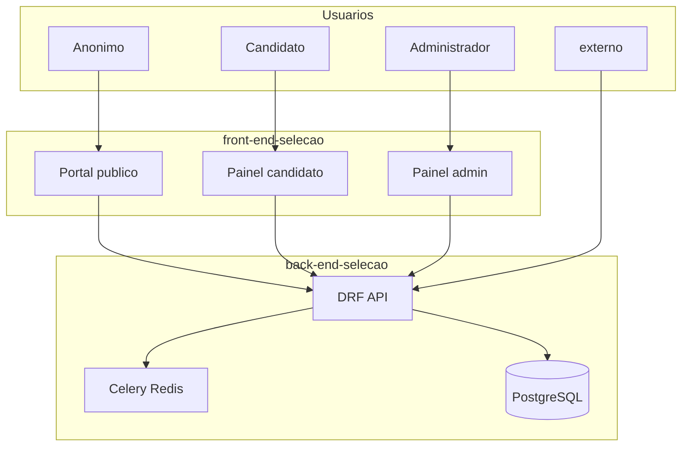

# Arquitetura

## Visão geral

O **Seleção Simplificada** é um monorepo com frontend Next.js e backend Django REST Framework. Candidatos se inscrevem em processos seletivos; administradores criam processos, avaliam em duas etapas e definem vencedores. O sistema externo consome atividades administrativas via API de integração.



## Papéis

| Papel | Acesso | Capacidades principais |
|-------|--------|------------------------|
| Anônimo | Portal público | Ver processos, editais, FAQ; não envia inscrição sem login |
| Candidato | `/candidato/*`, inscrição | Cadastro, verificação de e-mail, inscrição, perfil, status |
| Administrador | `/painel-admin/*` | CRUD de processos, análise (etapas 1 e 2), vencedores, admins (`super_admin`) |
| externo | `/api/integration/` | Pull de atividades (token estático) |

## Stack

### Backend (`back-end-selecao`)

- Django 5 + Django REST Framework
- JWT (SimpleJWT, access 1 dia, refresh 7 dias, rotação + blacklist)
- PostgreSQL, Redis (cache + Celery + OTP SMS)
- Celery + django-celery-beat
- drf-spectacular (Swagger/OpenAPI)
- Integrações: SMTP (e-mail), iSend SOAP (SMS), API externo

Apps Django: `core`, `selection`, `administrator`, `integration`.

### Frontend (`front-end-selecao`)

- Next.js 15 (App Router) + React 19
- Tailwind CSS + TanStack Query
- Cookies JWT separados para candidato e admin
- ViaCEP para endereço; mídia via rewrite `/media/*` → Django

## Domínio principal

```
User
 ├── AdministratorProfile (1:1)
 └── Candidate (1:1)
       └── Application (*) ── SelectionProcess
             ├── Stage1Evaluation (1:1)
             └── Stage2Evaluation (1:1)

SelectionProcess ── NoticeDocument (*)
IntegrationActivity / IntegrationToken (externo)
```

Detalhes de modelos: [../back-end-selecao/docs/MODELOS.md](../back-end-selecao/docs/MODELOS.md).
