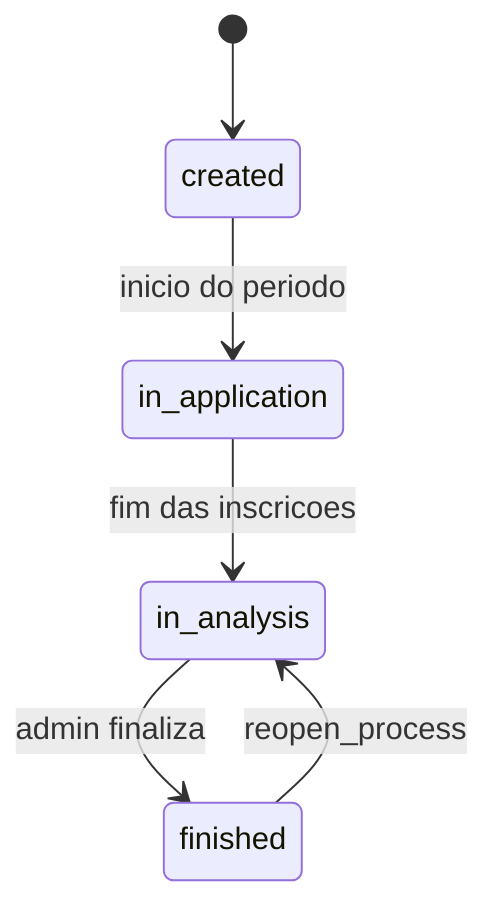

# Fluxos de negócio

## Ciclo do processo seletivo

Status principais (`SelectionProcess.status`):

| Status | Significado |
|--------|-------------|
| `created` | Criado; período de inscrição ainda não começou |
| `in_application` | Inscrições abertas |
| `in_analysis` | Período encerrado; análise em andamento |
| `finished` | Encerrado (ação administrativa) |

O Celery atualiza status automáticos com base nas datas (`update_selection_process_status`). O status `finished` é manual.

Há também estágio de análise (`AnalysisStage`): documentos (etapa 1) → entrevista (etapa 2) → conclusão.

## Inscrição do candidato

1. Processo disponível (`available_for_enrollment` / listagem pública).
2. Candidato autenticado com e-mail verificado.
3. Formulário em 3 passos (dados → documentos → extras).
4. `POST /api/selection/applications/` (multipart).
5. Edição possível enquanto o período estiver aberto (`/candidato/editar-inscricao/[id]`).

## Análise administrativa

1. **Etapa 1** — avaliação documental: `POST .../applications/{id}/stage1_evaluation/`
2. Avanço: `advance_to_stage2` no processo
3. **Etapa 2** — entrevista: `POST .../applications/{id}/stage2_evaluation/`
4. `complete_analysis` / geração de ranking e vencedores
5. Decisão do vencedor: `winner_decision`, `generate_winners`, `replace_winner`, `select_winners`
6. Finalizar ou reabrir: `finish_process` / `reopen_process`

Pesos dos critérios no processo devem somar 100% quando ativos.

## UI admin

A análise concentrada fica em `/painel-admin/processos/analise/[slug]`.
